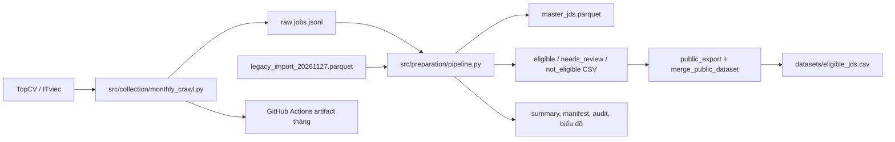

# Kiến trúc KHDL hiện hành

## Luồng phụ thuộc

`src/collection/targeted_role_crawl.py` là lệnh bổ sung cho các nghề dưới mục tiêu 80 JD. Nó dùng cùng bộ trích xuất và gọi cùng `src/preparation/pipeline.py` sau mỗi vòng có JD mới. `src/pipeline.py` là CLI chạy lại từ các đầu vào được chỉ rõ. Không còn chuỗi preparation v1/v2, M01, M02 hay luồng Gemini cũ trong source code hiện hành.

## Quy tắc tổ chức source

| Thành phần | Trách nhiệm | Không chứa |
|---|---|---|
| `crawlers/base.py`, `browser.py`, `config.py`, `site.py`, `topcv.py` | Trình duyệt, phân trang, danh sách TopCV | Phân loại nghề |
| `src/collection/topcv_detail.py` | Trích description TopCV, nhận biết challenge | Thao tác mở browser |
| `src/collection/targeted_role_crawl.py` | Truy vấn theo nghề, lấy JD TopCV/ITviec, checkpoint và giới hạn tải | Quy tắc eligibility độc lập |
| `src/collection/monthly_crawl.py` | Một snapshot tháng và gọi preparation | Nhãn LLM |
| `src/preparation/identity.py` | Chuẩn URL và ID bài TopCV | Browser |
| `src/preparation/pipeline.py` | Đọc input, eligibility, gộp bản trùng, ghi release/manifest | Mạng/API |
| `src/preparation/taxonomy.py` | Gán nhóm nghề, nghề chính và kỹ năng kèm bằng chứng | Ghi dữ liệu |
| `src/preparation/role_report.py`, `report.py` | CSV/biểu đồ/báo cáo | Thu thập dữ liệu |
| `src/preparation/public_export.py`, `merge_public_dataset.py` | Che thông tin liên hệ và cập nhật CSV công bố | Crawl hoặc thay đổi nhãn nghề |

## Tầng dữ liệu

- `data/raw/`: snapshot nguồn lịch sử và bản JSONL crawl được giữ lại. Không xoá nguồn gốc khi làm sạch code.
- `data/inputs/legacy_import_20261127.parquet`: bản nhập **10.226 nhóm** từ release cuối trước đợt dọn. Đây là văn bản đã xử lý, không chứng minh JD HTML gốc đầy đủ. `data/inputs/manifest.json` có SHA-256 và nguồn gốc.
- `data/monthly_crawl/<run-id>/`: kết quả một lần crawl theo lịch, gồm `jobs.jsonl`, log sự kiện/lỗi, `summary.json`, và `prepared/`.
- `data/targeted_crawl/<run-id>/`: checkpoint và dữ liệu crawl bổ sung nghề thiếu.
- `data/curated/preparation/<run-id>/`: release bất biến sau khi chạy trên các đầu vào được khai báo; có manifest SHA-256.
- `datasets/eligible_jds.csv`: JD phù hợp đã che thông tin liên hệ và được commit để thành viên dùng; tập tích lũy có thể chứa tin đã hết hạn.

`data/` bị Git bỏ qua. Runner GitHub bắt đầu trống; workflow tháng chuẩn bị dữ liệu crawl trong run đó rồi gộp các JD phù hợp vào CSV công bố. Những dòng cũ không được chuẩn bị lại theo quy tắc mới. Để tái tính corpus đầy đủ, tải snapshot tháng về và chạy `src.pipeline prepare` với bản nhập lịch sử cùng **mọi JSONL tháng muốn dùng**. Artifact GitHub tối đa 90 ngày; cần kho riêng để lưu raw JD dài hạn. Repo public không upload artifact JD đầy đủ.

## Ranh giới và giới hạn

- Chỉ `source_url`/ID TopCV chắc chắn mới được gộp tự động. Hai tin cùng nội dung nhưng URL khác có thể còn trùng.
- Mỗi JD chỉ có một `primary_role`; trường hợp mơ hồ giữ `unknown` và bằng chứng để xem xét. `eligible` không đồng nghĩa nghề đã rõ.
- `partial_jd` và `transformed_text` vẫn được phân tích theo quyết định của dự án, nhưng `content_quality_caveat` giữ dấu vết.
- Chrome chạy ẩn và dùng một phiên trong một invocation; challenge/429 dừng nguồn đó. Kết quả website có thể khác giữa máy cá nhân và GitHub runner.
- Các nhãn tự động chưa được hiệu chuẩn bằng gold độc lập; không nên dùng như nhãn sự thật khi huấn luyện mà không kiểm toán mẫu.
