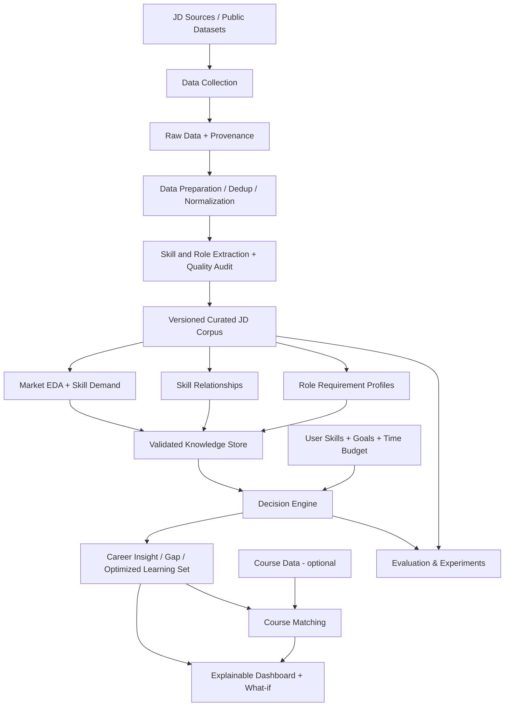

# ĐỀ XUẤT THIẾT KẾ DỰ ÁN IT4930 — DATA-DRIVEN IT CAREER & SKILL DEVELOPMENT

> **Phiên bản:** 1.0 — 18/11/2026  
> **Trạng thái:** Đề xuất nghiên cứu và đặc tả triển khai; **chưa phải kết quả thực nghiệm**.  
> **Đối tượng:** Nhóm 4 sinh viên môn IT4930 – Nhập môn Khoa học dữ liệu; giảng viên hướng dẫn; người triển khai/kiểm thử.  
> **Nguồn xây dựng:** Đề xuất tái thiết kế đã thống nhất trong hội thoại, tài liệu dự án `IT4930_Skill_Demand_Overleaf_Updated.pdf`, tài liệu `How_to_crawl_data.pdf` và ý tưởng tham khảo từ Lumina AI. Các ngưỡng nghiệm thu dưới đây là **ngưỡng đề xuất cần phê duyệt**, không phải kết quả đã đạt.

---

## 0. Tóm tắt một trang — Dự án là gì?

**Tên đề xuất:** *Data-Driven IT Career & Skill Development Decision Support System* (Hệ thống phân tích nhu cầu kỹ năng tuyển dụng và hỗ trợ quyết định phát triển năng lực IT dựa trên dữ liệu).

**Bài toán thực tế:** Một sinh viên có thể biết một số công nghệ nhưng không biết (a) những nghề IT nào có yêu cầu gần với năng lực hiện có; (b) nếu theo một nghề cụ thể thì đang thiếu kỹ năng gì; (c) với số giờ học hạn chế, nên học **tập kỹ năng nào** để bao phủ nhiều yêu cầu tuyển dụng nhất. Tự đọc từng JD tốn thời gian, thiếu tính tổng hợp và dễ thiên lệch bởi từ ngữ hoặc tin trùng.

**Ý tưởng:** Hệ thống lấy JD tuyển dụng IT thực tế, làm sạch, nhận diện kỹ năng, chuẩn hóa nghề, phân tích tần suất/quan hệ kỹ năng để tạo ra **tri thức thị trường có thể truy vết**. Người dùng nhập kỹ năng và mục tiêu; hệ thống không chỉ liệt kê kỹ năng thiếu mà còn xếp hạng lựa chọn nghề, giải thích bằng JD, so sánh các phương án học tập theo ngân sách thời gian và mô phỏng kết quả nếu bổ sung kỹ năng.

**Đóng góp nghiên cứu ưu tiên:** *Learning Skill Optimization under a Time Budget* — so sánh các phương pháp chọn kỹ năng cần học dưới cùng ngân sách giờ, đo mức tăng bao phủ trên **JD chưa dùng để xây mô hình**. Role Matching và phân tích thị trường là hai lớp hỗ trợ, không được tuyên bố là đo được xác suất trúng tuyển.

**Ba giá trị đầu ra:**

1. **Market Knowledge:** nhu cầu kỹ năng theo role/phân khúc, quan hệ đồng xuất hiện, chất lượng dữ liệu, bằng chứng JD;
2. **Career Insight:** các role đáng khám phá, phần trùng khớp/thiếu hụt, cảnh báo giới hạn;
3. **Learning Decision:** kế hoạch học kỹ năng theo ngân sách, mô phỏng What-if, giải thích lý do, khóa học (mở rộng).

**Không phải:** máy dự đoán trúng tuyển, bảng xếp hạng năng lực tuyệt đối, hay hệ thống cam kết việc làm. **Không phải** chỉ một website chatbot/crawler. Trọng tâm là pipeline Khoa học dữ liệu có thể tái lập và kiểm chứng.

### 0.1. Hai chế độ người dùng

| Chế độ | Đầu vào | Kết quả chính |
|---|---|---|
| **Explore** — chưa có nghề mục tiêu | Kỹ năng + level + sở thích (tùy chọn) | Danh sách role có dữ liệu đủ điều kiện, coverage, skill gaps và bằng chứng; không ép chọn một nghề |
| **Target** — đã chọn nghề | Role/specialization + kỹ năng + địa điểm/level + ngân sách giờ | Requirement Profile → Gap → chọn **tập kỹ năng** tối ưu → What-if → gợi ý học theo thứ tự nếu có prerequisite hợp lệ |

### 0.2. Ví dụ xuyên suốt (chỉ minh họa, không dùng làm số liệu kết luận)

Người dùng biết `Linux`, `Git`, `Docker`; muốn làm **DevOps Intern ở Hà Nội**; học **6 giờ/tuần** trong **4 tuần** (ngân sách 24 giờ). Hệ thống lọc JD phù hợp, trích xuất các yêu cầu như `CI/CD`, `Terraform`, `Kubernetes`; công bố số JD hợp lệ, phần thiếu dữ liệu và nguồn. Một bộ tối ưu chọn những kỹ năng đem lại mức bao phủ tăng tốt nhất trong 24 giờ; bảng kết quả có lợi ích ước tính, thời gian, lý do và JD minh chứng. Nếu không có ước lượng thời gian đáng tin cậy, hệ thống chỉ xếp hạng theo coverage và **không tạo lịch học giả chính xác**.

---

## 1. Mục tiêu và phạm vi nghiên cứu

### 1.1. Mục tiêu khoa học dữ liệu

- Xây dựng bộ dữ liệu JD IT có nguồn gốc, phiên bản, báo cáo chất lượng và quy trình có thể chạy lại.
- Đánh giá phương pháp **skill extraction/normalization** với nhãn độc lập; không coi kết quả do LLM trích xuất là ground truth.
- Khám phá nhu cầu kỹ năng và những kết hợp kỹ năng theo role/phân khúc bằng EDA, thống kê, association rules và graph.
- Xây dựng và đánh giá Role Matching bằng baseline và phương pháp có đặc trưng cấu trúc; chứng minh giới hạn của điểm so khớp.
- Mô hình hóa Skill Prioritization có ràng buộc ngân sách; so sánh baseline, greedy và (khi khả thi) nghiệm tối ưu trên trường hợp nhỏ.
- Kiểm thử tính vững của kết quả khi thay đổi dữ liệu, taxonomy, tham số và phân khúc.

### 1.2. Mục tiêu ứng dụng

- Người dùng biết **vì sao** một nghề/kỹ năng được gợi ý, thông qua dữ liệu minh chứng.
- Cho phép chọn hoặc đổi mục tiêu nghề, ngân sách học và mô phỏng thêm kỹ năng.
- Không mặc định 4 nghề; dùng **taxonomy nghề mở**, có điều kiện đủ dữ liệu trước khi so sánh.
- Khi nguồn học phù hợp được kiểm toán, nối kỹ năng ưu tiên với khóa học; không bắt buộc ở MVP Research.

### 1.3. Phạm vi MVP và phần mở rộng

| Phần | Bắt buộc (Research MVP) | Mở rộng khi đủ nguồn lực | Không cam kết trong học phần |
|---|---|---|---|
| JD | Một corpus chính, chuẩn hóa, có kiểm toán; thêm nguồn nếu cần | Crawl tăng độ phủ, định kỳ cập nhật | Bao phủ toàn bộ thị trường VN |
| Nghề | Taxonomy mở; phân tích các role đủ mẫu | Thêm DevOps, Cloud, AI/ML, Security theo audit | Cho điểm số mọi nghề dù không có dữ liệu |
| Phân tích | EDA, profile theo role, association analysis | Louvain/clustering nếu có câu hỏi rõ | Dự đoán thị trường tương lai không đủ mốc thời gian |
| Quyết định | Explore/Target, Skill Gap, budget optimization, What-if | Course Matching, lịch học, feedback | Chứng minh tỷ lệ trúng tuyển thực |
| Đánh giá | H1–H3, baseline, held-out test, leakage control, ablation | User study lớn, đánh giá dài hạn | Đo mức tăng năng lực thật khi chưa có pre/post test |

**Nguyên tắc chọn role:** `Role Family → Primary Role → Specialization → Seniority → Location`. Chỉ nhóm có đủ JD sau làm sạch mới được hiển thị điểm so sánh; nhóm ít dữ liệu được hiển thị với nhãn *exploratory/insufficient evidence*.

---

## 2. Input và Output tổng thể

### 2.1. Input ở cấp dự án (offline / định kỳ)

1. **Job postings:** title, JD text, company (nếu có), nguồn/link, địa điểm, level, thời điểm đăng nếu đáng tin; định dạng CSV/JSON/API/HTML.
2. **Role taxonomy:** từ điển nhóm nghề, alias chức danh, quy tắc đa nhãn, trạng thái duyệt.
3. **Skill dictionary:** canonical skill, alias, loại kỹ năng, phân biệt từ gần giống; nguồn taxonomy/phiên bản.
4. **Bộ nhãn đánh giá:** JD gán nhãn tay cho skill, role, seniority; một bộ hồ sơ–role do người đánh giá độc lập chấm mức phù hợp.
5. **Learning-cost/prerequisite (khi có):** số giờ ước tính với nguồn và độ tin cậy; quan hệ tiên quyết có kiểm chứng. Không được suy prerequisite từ co-occurrence.
6. **Course catalog (mở rộng):** tên khóa, skill taught, độ khó, thời lượng, URL, nguồn/cập nhật và tình trạng truy cập.

### 2.2. Input lúc người dùng sử dụng (online)

| Field | Bắt buộc | Ví dụ | Cách xử lý |
|---|---|---|---|
| `mode` | Có | `explore` / `target` | Quyết định luồng |
| `skills` | Có | `[{skill:"Docker", level:"basic"}]` | Canonicalize; giữ giá trị user khai báo |
| `target_role_id` | Với Target | `devops_engineer` | Validate taxonomy |
| `specialization` | Không | `cloud_aws` | Chỉ lọc khi có dữ liệu |
| `target_seniority` | Không | `intern` | Không tự suy đoán từ kỹ năng |
| `location` | Không | `Ha Noi` | Unknown giữ unknown |
| `hours_per_week` | Với lập kế hoạch | `6` | Số dương, có giới hạn hợp lý |
| `weeks` / `budget_hours` | Với tối ưu | `4` hoặc `24` | Kiểm tra nhất quán |
| `interests` | Không | `cloud`, `backend` | Ưu tiên mềm; không suy từ Python/Java |
| `what_if_skills` | Không | `["CI/CD"]` | Mô phỏng, không ghi người dùng đã thành thạo |
| `consent` | Nếu lưu hồ sơ | true/false | Không lưu thông tin cá nhân nếu chưa đồng ý |

### 2.3. Output cho người dùng

**A. Market Overview:** role filter; số JD trước/sau lọc; top skills và tỷ lệ xuất hiện; nguồn/địa điểm/level; bảng thiếu dữ liệu; liên kết JD minh chứng; đồ thị kỹ năng có giải thích.

**B. Career Exploration:** top-N role có *coverage* và cấu trúc kỹ năng tương đồng; evidence (matched, missing, JD count); cảnh báo khi dữ liệu ít hoặc các điểm chênh nhau không đáng tin; tuyệt đối không hiển thị “70% cơ hội trúng tuyển”.

**C. Targeted Gap:** requirement profile theo role/segment, có ba trạng thái `matched / missing / unknown`; nếu mức thành thạo chưa được xác thực, ghi rõ self-reported. Tách required/preferred chỉ khi có chứng cứ; nếu không để `mentioned`.

**D. Learning Decision:** danh sách kỹ năng hoặc tập kỹ năng được chọn; estimated gain trên corpus; chi phí thời gian và nguồn estimate; các ràng buộc; baseline comparison; what-if; coverage trước/sau và JD minh chứng.

**E. Course Plan (mở rộng):** khóa học có skill map, mức liên quan, thời lượng/chi phí nếu xác minh được, thứ tự theo prerequisite; không gắn nhãn khóa học “tốt nhất” khi không có validation.

**F. Research Output:** notebook, figure, confidence intervals / effect sizes phù hợp, bảng H1–H3, metrics, error analysis và README tái lập.

### 2.4. Ví dụ contract JSON (minh họa)

```json
{
  "request": {
    "mode": "target",
    "target_role_id": "devops_engineer",
    "target_seniority": "intern",
    "location": "ha_noi",
    "skills": ["Linux", "Git", "Docker"],
    "budget_hours": 24
  },
  "response": {
    "status": "ok",
    "corpus_version": "jd_v1",
    "cohort": {"role": "devops_engineer", "count_total": 0, "count_eligible": 0},
    "skill_gap": [],
    "recommended_skill_set": [],
    "coverage_before": null,
    "coverage_after_estimated": null,
    "evidence_jd_ids": [],
    "warnings": ["Example schema only; real metrics require a real cohort"]
  }
}
```

`0` và `null` ở ví dụ **không phải số liệu thực**, mà cho thấy hệ thống phải hỗ trợ trạng thái chưa đủ dữ liệu thay vì bịa chỉ số.

---

## 3. Kiến trúc pipeline và 4 lớp tri thức

### 3.1. Tổng quan end-to-end



*Trong mô hình này, Data Science không nằm ở frontend: nó nằm ở pipeline học tri thức từ corpus, kiểm định H1–H3 và thuật toán quyết định.*

### 3.2. Bốn lớp tri thức đề xuất

| Lớp | Nội dung lưu trữ | Cách học/xây | Trả lời câu hỏi gì? | Tính chất bằng chứng |
|---|---|---|---|---|
| **L1. Skill Demand Knowledge** | Tần suất và khoảng tin cậy theo role/level/location; `n` | EDA, thống kê | “Kỹ năng nào xuất hiện phổ biến trong nhóm JD này?” | Mô tả mẫu tin, không đại diện tự động cho thị trường |
| **L2. Skill Relationship Knowledge** | Co-occurrence, support/confidence/lift, communities; relation type | Association mining / Graph | “Những công nghệ nào thường được đề cập cùng nhau?” | Liên hệ thống kê ≠ prerequisite hoặc nhân quả |
| **L3. Role Requirement Profile** | Role-specific skill vector, distinctive skills, distribution, sample quality | Aggregate corpus, normalized/weighted features | “Backend khác DevOps ở những kỹ năng nào?” | Phụ thuộc dữ liệu và cách phân loại |
| **L4. Personalized Decision Model** | Role candidates, skill gap, optimized set, what-if, evidence | Matching + constrained optimization | “Tôi nên học gì trong 24 giờ để tăng coverage?” | Mô phỏng, không đo năng lực/trúng tuyển thực |

**Nguyên tắc kết nối:** L4 không được tạo kết luận trái với mức tin cậy của L1–L3. Bất cứ output định lượng nào đều phải mang theo `corpus_version`, `filter/cohort`, `n`, `method_version`, `warnings`, `evidence`.

### 3.3. Lưu trữ và các artefact khuyến nghị

```text
data/
  raw/                # original files + metadata, không ghi đè
  staging/            # parse intermediate
  curated/            # cleaned, normalized, deduped JD
  labels/             # gold sets; review logs
  taxonomy/           # role_catalog.json, skill_aliases.json
  external/           # learning cost / prerequisite / course data
  manifests/          # provenance, source license, version, checksums
artifacts/
  quality/            # quality_report.json, dedup_report.csv
  models/             # role_profiles, saved params, fit metadata
  knowledge/          # demand table, relationship edges, graph features
  evaluation/         # metrics, plots, errors, hypothesis tests
src/
  collection/
  preparation/
  extraction/
  analysis/
  decision/
  evaluation/
  app/
tests/
notebooks/
README.md
requirements.txt
```

---

## 4. Dữ liệu cần thu thập, schema và khả năng sử dụng

### 4.1. Nguồn ưu tiên và thứ tự sử dụng

| Ưu tiên | Dữ liệu | Vai trò | Rủi ro / lưu ý |
|---|---|---|---|
| P0 | **Vietnamese IT Job Posting Data** (GitHub, nguồn đã nêu trong đề xuất IT4930) | Corpus MVP | Kiểm toán lại số bản ghi, loại role, độ phủ trường; các nhãn skill từ LLM không phải ground truth |
| P1 có điều kiện | **Tinix Vietnamese Job Descriptions** | Mở rộng nghề/level/time | Lọc IT, kiểm tra giấy phép, cross-source dedup, không gộp năm không đồng nhất |
| P1 có điều kiện | Dữ liệu JD crawl hợp lệ (ITviec/TopCV/TopDev...) | Bổ sung DevOps/Cloud/AI thiếu mẫu | Điều khoản truy cập, robots, rate limit, chống trùng và lệch nguồn |
| P0 | Từ điển chuẩn skill và role nội bộ; ESCO tham khảo | Chuẩn hóa | Kiểm duyệt alias, giữ ngữ cảnh; `Java` ≠ `JavaScript` |
| P1 | Bộ nhãn gán tay kỹ năng/role/profile | Đánh giá độc lập | Độc lập dữ liệu train; có adjudication khi bất đồng |
| P2 | Coursera catalog hoặc dữ liệu khóa hợp lệ | Course matching | Link chết, thông tin thiếu, độ phủ kỹ năng, điều khoản sử dụng |
| P2 | Prerequisite / learning hours được kiểm chứng | Cost-aware optimization | Không suy từ lift; thiếu nguồn thì giảm phạm vi |

**Không cần crawl để có tất cả dữ liệu:** ESCO và một số dataset có thể download chính thức. Các bảng `jd_skill_demand`, `role_profiles`, `skill_graph` phải **tính từ curated corpus**, không phải những dữ liệu tự tìm kiếm trên Internet.

### 4.2. Schema chuẩn cho một JD

| Field | Type | Bắt buộc? | Ghi chú |
|---|---|---|---|
| `jd_id` | string | Có | ID nội bộ bền vững |
| `source`, `source_record_id`, `source_url` | string | Có khi có sẵn | Provenance; URL có thể thiếu nếu dataset gốc không cung cấp |
| `title_raw`, `description_raw` | string | Có | Lưu nguyên bản |
| `company_raw` | string/null | Không | Dùng dedup khi có |
| `posted_at` | date/null | Không | Không suy từ thời điểm crawl |
| `location_raw`, `location_norm` | string/null | Không | Null nếu không xác định |
| `seniority_raw`, `seniority_norm` | string/null | Không | Không tự đoán |
| `role_family`, `primary_role` | string/null | Có sau gán nhãn hợp lệ | Cho phép `unknown` |
| `role_tags` | array | Không | Multi-label phụ, không cộng trùng trong thống kê role chính |
| `specialization` | string/null | Không | Java Backend, MLOps, v.v. |
| `skills` | array of objects | Có thể rỗng | `{canonical, evidence_span, requirement_type, extractor_version, confidence}` |
| `content_hash`, `duplicate_cluster_id` | string | Có | Phòng data leakage; audit |
| `quality_flags` | array | Có | Missing, uncertain, truncated, suspected duplicate |
| `collection_timestamp`, `pipeline_version` | string | Có | Tái lập |

### 4.3. Ba cấp trạng thái chất lượng dữ liệu

- **Raw:** dữ liệu tải về, giữ nguyên, phục vụ truy vết.
- **Curated:** đã kiểm tra schema, normalize và dedup, có thể đưa vào EDA.
- **Eligible for decision:** JD đủ điều kiện cho role/level/location, có ≥1 kỹ năng đáng tin; dùng để tính coverage. Cần công bố các mẫu số khác nhau (`n_raw`, `n_curated`, `n_eligible`).

### 4.4. Chính sách dữ liệu và đạo đức

- Tuân thủ ToS, giấy phép dữ liệu, yêu cầu truy cập và giới hạn tải; không vượt CAPTCHA/chặn truy cập trái phép.
- CV/hồ sơ cá nhân là dữ liệu nhạy cảm với mục đích sử dụng: ưu tiên input kỹ năng tối thiểu, lưu khi có sự đồng ý, có cách xóa.
- Không thu thập số điện thoại/email không cần thiết từ JD; ẩn thông tin cá nhân nếu xuất bộ dữ liệu nghiên cứu.
- Lưu manifest: bản nguồn, thời điểm thu thập, license, checksum, script version và chính sách lưu trữ.

---

## 5. Pipeline module-by-module: chức năng, input, output, tiêu chuẩn nghiệm thu

> **Ký hiệu:** P0 = bắt buộc trong MVP; P1 = nên có nếu đủ dữ liệu; P2 = mở rộng. Ngưỡng định lượng dưới đây là **mục tiêu khởi tạo đề xuất**; nhóm cần chốt trước khi chạy test và ghi nhận cả trường hợp không đạt.

### M01 — Data Collection & Provenance (P0)

**Mục đích:** tạo nguồn JD hợp lệ, có thể truy vết và tái tải.

**Input:** URL/dataset file, quy tắc lấy dữ liệu, metadata nguồn, license/ToS.  
**Xử lý:** tải hoặc crawl đúng quyền; lưu raw; retry hợp lệ; log trạng thái, lỗi, checksum; validate URL nếu có fetch URL người dùng nhập.  
**Output:** `data/raw/*`, `source_manifest.csv/json`, `collection_log.json`, snapshot ID.

**Tiêu chuẩn nghiệm thu:**

- [ ] 100% bản ghi raw có `source` và `source_record_id` hoặc ID/hash thay thế có thể truy vết.
- [ ] Có bảng số bản ghi theo nguồn, ngày ingest và trạng thái thành công/thất bại.
- [ ] Re-run cùng nguồn snapshot không tạo bản ghi raw trùng ID ngoài ý muốn (idempotent import).
- [ ] Một nguồn lỗi không làm mất toàn bộ bản đã thu thập; lỗi được log và có thể thử lại hợp lệ.
- [ ] Giấy phép/quy định truy cập đã được kiểm tra; không khai thác dữ liệu ngoài quyền sử dụng.
- [ ] Bộ dữ liệu raw có manifest/checksum, người khác có thể tái dựng hoặc biết rõ lý do không thể tái tải.

**Bằng chứng nghiệm thu:** script, log, manifest, sample raw và hướng dẫn chạy.

### M02 — Data Preparation, Schema Integration & Deduplication (P0)

**Mục đích:** biến JD từ các nguồn thành dữ liệu có cấu trúc đáng tin cậy.

**Input:** raw JD, schema mapping, các quy tắc chuẩn hóa.  
**Xử lý:** parse HTML/JSON → thống nhất trường → missing analysis → normalize title/location/level → exact/near duplicate clustering → quality flags.  
**Output:** `curated_jds.parquet/csv`, `dedup_clusters.csv`, `quality_report.json`, `schema_mapping.md`.

**Tiêu chuẩn nghiệm thu:**

- [ ] Có thống kê trước/sau: tổng, missing per field, tỷ lệ duplicate, tỷ lệ unknown role/level/location.
- [ ] Không tự điền seniority, location, date nếu không có bằng chứng; giữ `unknown/null`.
- [ ] Kiểm tra thủ công mẫu near-duplicate; ghi rõ lỗi gộp nhầm và bỏ sót.
- [ ] `jd_id` duy nhất ở curated; mỗi JD được gắn provenance và dấu vết bản gốc.
- [ ] Không lẫn bản ghi cùng duplicate cluster giữa train và held-out evaluation.
- [ ] Pipeline tái lập, cùng version và input cho cùng output (trừ metadata thời gian chạy).
- [ ] Có ≥20 unit tests cho normalization/dedup/unknown và tình huống biên (mục tiêu đề xuất).

**Bằng chứng:** before/after report, notebook audit, bộ ví dụ trước/sau và test log.

### M03 — Role Taxonomy & JD Role Classification (P0)

**Mục đích:** phân loại nghề nhiều cấp thay vì khóa cứng 4 role.

**Input:** JD title/description, `role_catalog`, alias, nhãn gán tay.  
**Output:** `role_family`, `primary_role`, `specialization`, `role_tags`, `confidence`, `review_status`.

**Tiêu chuẩn nghiệm thu:**

- [ ] Danh mục mở, thêm role mới bằng data/config mà không sửa logic score.
- [ ] Hỗ trợ Fullstack, DevOps, Cloud, AI/ML, Data Engineer... **ở cấp taxonomy**; chỉ bật phân tích số khi đủ JD.
- [ ] Có nhãn `unknown/ambiguous` và hàng đợi review; không ép mọi JD vào 1 trong 4 nghề.
- [ ] JD multi-role có `primary_role` và tag phụ; quy tắc thống kê không đếm trùng.
- [ ] Đo confusion matrix + precision/recall/F1 (macro) trên bộ nhãn độc lập; báo cáo theo role.
- [ ] **Mục tiêu thử nghiệm**: Macro F1 ≥ 0.80 cho các role đủ mẫu; nếu không đạt phải phân tích lỗi, không được tuyên bố phân loại chính xác.

**Bằng chứng:** taxonomy file, annotation guide, test set, `role_classification_report.md`.

### M04 — Skill Extraction, Canonicalization & Evidence Audit (P0)

**Mục đích:** chuyển JD text thành kỹ năng chuẩn mà không bị ảo giác.

**Input:** curated JD, skill aliases, taxonomy, candidate extractor (regex/dictionary/context).  
**Output:** `jd_skills` kèm `skill_id`, `evidence_span`, `requirement_type`, trạng thái confidence và extractor version.

**Tiêu chuẩn nghiệm thu:**

- [ ] Không gộp nhầm Java/JavaScript, Spring/Spring Boot khi ngữ cảnh không cho phép; có test regression.
- [ ] Trích xuất `evidence_span` có offset hoặc đoạn trích từ JD; skill không chứng minh được ghi `uncertain`, không khẳng định chắc chắn.
- [ ] Bộ 100–150 JD gán nhãn thủ công **là mục tiêu ban đầu**, tách dev/test; ưu tiên hai người gán một tập con để đo đồng thuận.
- [ ] So sánh keyword baseline, aliases baseline và method đề xuất bằng precision/recall/F1; báo cáo macro/micro nếu phù hợp.
- [ ] **Mục tiêu thử nghiệm**: F1 ≥ 0.80 trên gold test và tốt hơn baseline theo tiêu chí chốt trước; nếu không đạt phải công bố.
- [ ] Missing skill và requirement type (`required/preferred/mentioned/unknown`) không được tự suy diễn khi JD mơ hồ.

**Bằng chứng:** `gold_skills.csv`, annotation guideline, evaluation report, error cases.

### M05 — Market EDA & Skill Demand Knowledge (P0)

**Mục đích:** học tri thức mô tả nhu cầu kỹ năng từ corpus có chất lượng.

**Input:** eligible JD + role/segment + extracted skills.  
**Output:** bảng tần suất theo cohort, biểu đồ phân phối, missingness, điều kiện sử dụng và `n`.

**Tiêu chuẩn nghiệm thu:**

- [ ] Mỗi tỷ lệ có mẫu số minh bạch, định nghĩa nhóm lọc và corpus version.
- [ ] Bảng/biểu đồ thống nhất với SQL/Pandas kiểm tra độc lập; chênh lệch do rounding được giải thích.
- [ ] Phân tích tác động dedup/normalization lên top-k skill.
- [ ] Các nhóm quá ít dữ liệu có cảnh báo; không vẽ kết luận xu thế thời gian nếu thiếu timestamp đáng tin.
- [ ] Khi kiểm định khác biệt, ghi hiệu ứng/CI/p-value (nếu thích hợp) và hiệu chỉnh multiple tests khi cần.
- [ ] Có ít nhất 3 insight **có bằng chứng JD cụ thể**, kèm giới hạn (mục tiêu đề xuất, không giả định trước kết quả).

**Bằng chứng:** EDA notebook, demand tables, figures, interpretation report.

### M06 — Skill Relationship Knowledge / Graph (P0 mức cơ bản, P1 communities)

**Mục đích:** khám phá skill xuất hiện cùng nhau, dùng để giải thích cấu trúc thị trường, không tự tạo prerequisite.

**Input:** danh sách skill per JD đã chuẩn hóa và cohort filters.  
**Output:** co-occurrence matrix, support/confidence/lift, graph edge list, (tùy chọn) community labels.

**Tiêu chuẩn nghiệm thu:**

- [ ] Tính support/confidence/lift đúng cùng mẫu số; kiểm chứng bằng ví dụ tính tay.
- [ ] Quy định min-support, min-count trước khi phân tích; hiển thị số trường hợp chung.
- [ ] So sánh độ ổn định cạnh/nhóm qua thay đổi ngưỡng hoặc bootstrap khi đủ dữ liệu.
- [ ] Phân biệt rõ `co_occurs_with`, `similar_to` và `prerequisite_of` trong schema; chỉ loại cuối lấy từ nguồn/kiểm duyệt riêng.
- [ ] Không suy quan hệ nhân quả hoặc thứ tự học từ lift > 1.

**Bằng chứng:** graph outputs, sanity tests, minh họa edge có JD evidence.

### M07 — Role Requirement Profile & Role Matching (P0 baseline, P1 nâng cao)

**Mục đích:** tạo profile kỹ năng cho nghề và xếp hạng những nghề đáng khám phá.

**Input:** role-specific JD, user skills, interests (nếu có), filter seniority/location.  
**Output:** `role_profile` (skill distributions, n, confidence), top-N `role_candidates` (coverage, match explanation, warnings).

**Tiêu chuẩn nghiệm thu:**

- [ ] Có baseline `average JD skill coverage`, trường hợp tập skills rỗng/đầy đủ/unknown.
- [ ] Trước khi score: kiểm tra `n_total`, `n_eligible`, skill extraction coverage và phân khúc bị mất dữ liệu.
- [ ] Nâng cao: weighted matching/graph-based features chỉ được chọn nếu vượt baseline trên nhãn độc lập.
- [ ] Nhãn đánh giá hồ sơ–role do người chấm độc lập, **không** sinh từ chính scoring formula.
- [ ] Báo cáo NDCG@K/Recall@K (khi bộ nhãn cho phép), theo role và loại hồ sơ; có bootstrap CI nếu đủ mẫu.
- [ ] Khi không đủ bằng chứng, trả `insufficient_data`, không xếp hạng cưỡng ép; không gọi score là job readiness/trúng tuyển.

**Bằng chứng:** role profiles, test profiles/labels, comparison report, các trường hợp sai.

### M08 — Evidence-based Skill Gap (P0)

**Mục đích:** phát hiện phần yêu cầu chưa được user skills bao phủ theo nghề mục tiêu.

**Input:** S (user skills canonical), role cohort J, extracted requirement sets R_j.  
**Output:** matched/missing/unknown, skill demand, JD evidence, coverage ban đầu.

**Định nghĩa MVP:**

\[
C(S,J^+)=\frac{1}{|J^+|}\sum_{j\in J^+}\frac{|S\cap R_j|}{|R_j|}, \quad
J^+=\{j\in J:|R_j|>0\}.
\]

**Tiêu chuẩn nghiệm thu:**

- [ ] Coverage đúng tính tay với test toy; không chia 0 khi J+ rỗng.
- [ ] Kết quả luôn kèm `|J|`, `|J+|`, tỷ lệ JD không extract được skill.
- [ ] User không khai báo skill → `not_declared` chứ không kết luận chắc chắn không biết; tránh đánh đồng tự khai báo với năng lực được kiểm tra.
- [ ] Required và preferred có trọng số riêng **chỉ nếu trích xuất đáng tin**; nếu không thì dùng mentioned + cảnh báo.
- [ ] Mỗi skill gợi ý có provenance và ví dụ JD; test synonyms, ambiguous, duplicate, empty, multiple roles.

**Bằng chứng:** unit tests, API examples, hand-calculated examples, error report.

### M09 — Budget-aware Skill Prioritization / Optimization (P0 — đóng góp trung tâm)

**Mục đích:** lựa chọn tập kỹ năng học, không chỉ xếp hạng từng kỹ năng rời rạc.

**Input:** user skill set S; cohort J; eligible missing skills A; budget B; cost estimate c(s); prerequisite edges được kiểm chứng.  
**Output:** tập kỹ năng A', expected coverage gain, cost, alternative solutions, constraint evidence.

**Mô hình cơ bản:**

\[
\max_{A'\subseteq A} C(S\cup A',J)-C(S,J)
\quad\text{s.t.}\quad \sum_{s\in A'}c(s)\le B.
\]

**Đối chứng:** Frequency top-k (đưa về cùng budget); Greedy gain/cost; exact knapsack trên tập nhỏ để làm benchmark (khi cost và gain cộng tính). Có thể thử dependency-aware optimization khi dữ liệu prerequisite đủ tin cậy.

**Tiêu chuẩn nghiệm thu:**

- [ ] Không có phương án vượt ngân sách; đảm bảo prerequisite đã duyệt; `unknown_cost` không được coi là 0 giờ.
- [ ] Khi cost thiếu, chuyển về mode `coverage_only` hoặc yêu cầu người dùng đưa giả định; hiển thị rõ.
- [ ] Kết quả trên toy dataset được đối chiếu brute-force/exact solver; kiểm tra tie, budget=0, item quá đắt, prerequisites cyclic.
- [ ] Báo cáo held-out coverage gain trên JD test tách từ đầu; so sánh cùng ngân sách và cùng input với baseline.
- [ ] **Tiêu chí khoa học:** H3 chỉ được coi là được ủng hộ nếu phương pháp đề xuất cải thiện chỉ số đã chọn so với baseline, có phân tích biến thiên/uncertainty; không bắt buộc cải thiện để đạt yêu cầu báo cáo trung thực.
- [ ] Có ablation cost/prerequisite/weight và báo cáo khi thuật toán không hơn baseline.

**Bằng chứng:** optimizer code, exhaustive small-instance tests, benchmark notebook, H3 report.

### M10 — What-if Simulator & Explainability (P0)

**Mục đích:** giúp người dùng tự đánh giá phương án thay đổi kỹ năng.

**Input:** current result + added/removed skills + budget/target filters.  
**Output:** coverage_before/after, marginal gain, changed decisions, JD evidence, warnings.

**Tiêu chuẩn nghiệm thu:**

- [ ] Thêm skill đã có không làm tăng coverage giả; không tạo số âm/bất hợp lệ.
- [ ] Công thức delta được test bằng phép tính tay; cùng input/version trả output nhất quán.
- [ ] Phân biệt `projected coverage` với `verified competence` và `employment probability`.
- [ ] Mọi thông số có nguồn hoặc ghi rõ giả định; UI chỉ ra lý do phương án xếp trên phương án khác.

**Bằng chứng:** what-if tests, screenshot/demo 2 kịch bản và source tracing.

### M11 — Course Matching & Learning Plan (P2 / mở rộng)

**Mục đích:** chuyển tập kỹ năng đề xuất thành tài nguyên học thực tế, không phải phần chứng minh cốt lõi.

**Input:** optimized missing skills + Coursera catalog/license + user language/level/time preferences.  
**Output:** courses with skill coverage, ranking rationale, cost/duration caveats, optional milestones.

**Tiêu chuẩn nghiệm thu khi bật tính năng:**

- [ ] Mỗi course có URL hợp lệ, skill mapping có bằng chứng từ mô tả/learning outcomes.
- [ ] Đánh giá Precision@K/NDCG@K trên skill-course pairs gán nhãn độc lập; không đồng nhất số lượng course với chất lượng.
- [ ] Không hiển thị duration/tên khóa sai nếu dữ liệu thiếu hoặc cũ; có `last_verified_at`.
- [ ] Không tạo prerequisite tự động từ co-occurrence; kiểm tra chu trình trước khi topological sort.
- [ ] Nếu không có course đủ phù hợp, trả `no_verified_course`, không gợi ý bừa.

**Bằng chứng:** catalog QA, gold pairs, recommender evaluation, link checker.

### M12 — Dashboard, API, Usability (P0 dạng gọn)

**Mục đích:** trình bày tri thức và kết quả quyết định cho người không học DS.

**Input:** outputs M05–M10 (M11 nếu bật).  
**Output:** Explore/Target flows; bảng/biểu đồ; thư mục demo; export report.

**Tiêu chuẩn nghiệm thu:**

- [ ] 2 luồng Explore và Target chạy end-to-end với corpus thật và dữ liệu sample minh bạch.
- [ ] Mỗi biểu đồ có title, `n`, filter, unit và thông báo thiếu dữ liệu; số liệu khớp pipeline.
- [ ] Người dùng xem được “Why this role/skill?” và evidence JD; không chỉ thấy một con số.
- [ ] Thử nghiệm với tối thiểu 5 người (ngưỡng pilot đề xuất), yêu cầu hoàn thành các tác vụ: chọn role, xem evidence, thay đổi budget, thử what-if; ghi kết quả và feedback, không suy rộng hiệu quả tuyển dụng.
- [ ] Hệ thống xử lý missing/error/empty gracefully; không crash khi role chưa đủ dữ liệu.

**Bằng chứng:** demo video/screenshots, task completion log, E2E test logs.

### M13 — Experimental Evaluation, Reproducibility & Reporting (P0 — xuyên suốt)

**Mục đích:** chứng minh/công bố kết quả bằng thực nghiệm có thể tái lập, không chỉ demo chức năng.

**Input:** corpus/splits/gold sets, predictions, experiment configs/seeds.  
**Output:** baseline tables, H1–H3 report, ablation, confidence/limitations, final slides and report.

**Tiêu chuẩn nghiệm thu:**

- [ ] Có data manifest, frozen split, seed, dependency versions, script chạy một lệnh (hoặc notebook hướng dẫn rõ).
- [ ] Không có duplicate cluster leakage qua các tập; gold test độc lập với tuning.
- [ ] Metrics gắn trực tiếp với câu hỏi nghiên cứu; không cherry-pick case đẹp.
- [ ] H1/H2/H3 đều có: giả thuyết, dữ liệu, baseline, metric, kết quả, phân tích lỗi và kết luận (ủng hộ/chưa ủng hộ/không đủ dữ liệu).
- [ ] Nếu H2 thiếu nhãn phù hợp role, phải giảm scope thành exploratory và công bố lý do, không tạo nhãn vòng tròn từ score.
- [ ] Có ablation/sensitivity theo nguồn và role; báo cáo dữ liệu không đủ và bias.
- [ ] Ít nhất một người khác trong nhóm clone/chạy lại thành công theo README.

**Bằng chứng:** `evaluation/` + `report.pdf` + README + Git commit/tag.

---

## 6. Ba giả thuyết nghiên cứu mới và sơ đồ liên kết

| H | Câu hỏi có thể bác bỏ | Biến/đối chứng | Dữ liệu kiểm tra | Metric chính | Tác động sản phẩm |
|---|---|---|---|---|---|
| **H1** | Context + normalization cải thiện trích xuất skill so với keyword baseline? | Keyword vs alias vs contextual | JD gold annotations | F1/Precision/Recall và CI | Nền tảng độ đúng Skill Gap, EDA |
| **H2** | Role Matching sử dụng đặc trưng cấu trúc tốt hơn overlap? | Simple overlap vs weighted/graph matching | Profile–role human labels độc lập | NDCG@K, Recall@K | Career Exploration (chỉ khi tốt hơn) |
| **H3** | Chọn kỹ năng theo gain/cost/prerequisite tốt hơn frequency theo cùng thời gian? | Frequency vs greedy vs optimized | Held-out JD + cost assumptions | Coverage gain cùng budget, constraint violations | Learning Decision / kế hoạch học |

**Quy định nghiên cứu:** ghi rõ H0/H1 của từng phép thử khi chọn kiểm định; predefine metric, threshold/alpha, seed, split và quy tắc xử lý trường hợp không đủ mẫu. Không tuyên bố “độ chính xác cao” chỉ từ một demo.

### 6.1. Vai trò của các nghiên cứu thị trường trong bản cũ

- **Before/after dedup/normalization:** dùng làm kiểm tra chất lượng và giải thích ảnh hưởng lên top skills.
- **Co-occurrence/lift/community:** lớp tri thức L2, giúp hiểu những bộ kỹ năng cùng xuất hiện và làm feature candidate cho H2, **không suy trực tiếp thành prerequisite**.
- **Level/location differences:** EDA phân khúc, đánh giá khả năng tổng quát hóa của role profiles; chỉ kiểm định khi đủ mẫu.

### 6.2. Benchmark và chống leakage

- Tách raw corpus theo **duplicate groups**, không chia ngẫu nhiên từng bản ghi trùng lặp.
- Freeze test trước khi thiết kế/tối ưu heuristic; train/dev/test không dùng chung nhãn.
- Tách hoặc stratify theo role/source/time (nếu có) và ghi chênh lệch phân phối.
- So sánh tại cùng cohort, budget, số kỹ năng, dữ liệu được phép dùng và phương thức tính coverage.
- Báo cáo confidence interval bằng bootstrap khi phù hợp; kết quả trên mẫu nhỏ được ghi rõ exploratory.

---

## 7. Định nghĩa chất lượng và tiêu chuẩn nghiệm thu tổng thể

### 7.1. Definition of Done theo giai đoạn

| Gate | Chỉ được đi tiếp khi | Tài liệu chứng minh |
|---|---|---|
| **G0 — Research Design** | Câu hỏi nghiên cứu, H1–H3, metrics, baseline, schema, phạm vi MVP và rủi ro đã chốt | Proposal, experiment plan |
| **G1 — Data Ready** | Raw + manifest + curated + quality report; splits không leakage | Data audit, ETL tests |
| **G2 — Knowledge Ready** | Skill extraction có đánh giá; role profiles, demand table, graph có kiểm thử | Extraction/EDA reports |
| **G3 — Decision Ready** | Role matching + gap + optimizer chạy; edge cases đạt; output có evidence | APIs, unit/integration tests |
| **G4 — Evaluation Ready** | Baselines và test độc lập; H1–H3 có kết luận và lỗi phân tích | Evaluation report |
| **G5 — Presentation Ready** | Demo, reproducibility, báo cáo/slide dễ hiểu, không trình bày giả định là kết quả | README, demo, slide, report |

### 7.2. Tiêu chuẩn bắt buộc xuyên module

1. **Traceability:** mọi số liệu phải nối được về raw snapshot, processed corpus, filter, metric và version.
2. **Reproducibility:** scripts/notebooks chạy lại; fixed seed nếu có thuật toán ngẫu nhiên.
3. **No fabricated evidence:** dữ liệu thiếu trả `unknown/insufficient_data`, không tự điền.
4. **No misleading interpretation:** coverage là độ bao phủ yêu cầu được nhận diện, không phải xác suất trúng tuyển hoặc năng lực đã kiểm chứng.
5. **Baseline first:** phương pháp mới phải được so với baseline công bằng, công bố cả khi không hơn.
6. **Error analysis:** có bảng case sai/mơ hồ, không chỉ báo cáo điểm tổng.
7. **Scope discipline:** không mở rộng Course Matching nếu Data/Decision/Evaluation chưa ổn.
8. **Source hygiene:** license, ToS, dữ liệu cá nhân và quyền truy cập hợp lệ.

### 7.3. Mục tiêu chất lượng đề xuất (không phải rubric giảng viên)

| Thành phần | Mục tiêu khởi tạo | Khi không đạt |
|---|---|---|
| Role classification | Macro F1 ≥ 0.80 trên nhóm đủ mẫu | Gộp role hiếm vào exploratory hoặc cải thiện taxonomy; báo cáo lỗi |
| Skill extraction | F1 ≥ 0.80, so sánh baseline | Giữ baseline tốt nhất; tăng audit, không giả độ chính xác |
| Data provenance | 100% row có ID/nguồn truy vết | Chặn phiên bản corpus không hợp lệ |
| Coverage math | 100% unit tests tình huống biên | Không phát hành module |
| Budget optimizer | 0 phương án vi phạm hard constraints | Không phát hành module |
| Dashboard | 2 flow chạy E2E; tối thiểu 5 pilot testers | Sửa luồng/giải thích theo feedback |
| H1–H3 | Đủ bảng so sánh/nhãn/method/kết luận | Ghi rõ “không đủ điều kiện kiểm định” thay vì ép kết luận |

---

## 8. Kế hoạch triển khai thực tế, thứ tự phụ thuộc

### 8.1. Workstreams của 4 người

| Thành viên | Chủ sở hữu chính | Contract bàn giao | Trách nhiệm nghiên cứu/báo cáo |
|---|---|---|---|
| **P1 — Data Engineer/Analyst** | M01–M02 + hỗ trợ M04 | Raw/curated corpus, schema, provenance, QA | Data section, pipeline figure, data audit |
| **P2 — Role & Market Analyst** | M03, M05, M07 | Taxonomy, role profiles, role matching baselines | H2, role evaluation, market insights |
| **P3 — Skill & Optimization Analyst** | M06, M08–M10 | Skill graph, gap engine, optimizer, comparison | H3, optimization tests, error analysis |
| **P4 — Integration/Evaluation Lead** | M04 evaluation phối hợp, M12–M13 | Gold labels framework, E2E app, experiment harness | H1 + experiment orchestration, tổng hợp slide/report |

**Điều chỉnh bắt buộc:** tất cả thành viên tham gia gán nhãn và kiểm thử chéo; P4 không phải người duy nhất làm báo cáo. Mỗi PR có owner/reviewer; thay đổi schema cần thông qua cả nhóm.

### 8.2. Roadmap theo mốc, không gán ngày tùy tiện

1. **Milestone 0 — Khóa thiết kế:** giảng viên xác nhận bài toán trung tâm, dữ liệu khả dụng, H1–H3 và phạm vi MVP.
2. **Milestone 1 — Data Foundation:** raw snapshot, curated, taxonomy, missing/duplicate report, frozen split.
3. **Milestone 2 — Knowledge Layer:** extraction benchmark, role profiles, EDA, skill graph.
4. **Milestone 3 — Decision Engine:** explore/target, gap, optimization, what-if, validations.
5. **Milestone 4 — Evaluation:** baseline, held-out, ablation, H1–H3, robustness.
6. **Milestone 5 — Communication:** dashboard E2E, user pilot, báo cáo và slide; Course Mapping chỉ nếu gates trước đạt.

### 8.3. Những quyết định cần xác nhận sớm với giảng viên

- Có được dùng tập dữ liệu công khai/LLM-extracted làm corpus gốc không, với cam kết kiểm toán nhãn?
- Giảng viên ưu tiên nghiên cứu H1–H3 như hiện đề xuất hay muốn thu hẹp H2 khi thiếu bộ nhãn hồ sơ–role?
- Cần số lượng JD tối thiểu theo role/segment bao nhiêu để được phép so sánh?
- Có thể coi công sức học là một biến ước lượng giả định để đánh giá thuật toán H3, hay cần nguồn xác thực?
- Những phần ngoài MVP như Coursera, course sequencing có cần demo không?
- Đồ án ưu tiên những chỉ số đánh giá và artefact nào ngoài rubric công khai của học phần?

---

## 9. Test cases nghiệp vụ tối thiểu

| TC | Điều kiện | Kết quả mong đợi |
|---|---|---|
| TC01 | Người dùng chưa nhập skill | Explore không crash; coverage 0 nếu cohort đủ dữ liệu, cảnh báo self-report |
| TC02 | Target role không đủ JD | `insufficient_data`, không score/gợi ý chắc chắn |
| TC03 | JD không trích được kỹ năng | Không được dùng trong mẫu số `J+`, nhưng vẫn đếm trong `J` và báo thiếu |
| TC04 | Skill alias `JS` có ngữ cảnh mơ hồ | Không gộp tùy tiện sang JavaScript nếu không đủ bằng chứng |
| TC05 | JD ghi Java và JavaScript | Hai skill tách biệt |
| TC06 | Nhiều bản sao cùng JD | Dedup trước khi thống kê; không leakage train/test |
| TC07 | User thêm skill đang có | What-if coverage gain = 0 |
| TC08 | Budget = 0 | Recommended skill set rỗng, cost 0 |
| TC09 | Skill có cost unknown | Không giả cost=0, fallback hợp lệ |
| TC10 | Prerequisite cycle | Báo lỗi dữ liệu/prerequisite; không tạo learning order sai |
| TC11 | Candidate role đa nhãn | Primary role đếm một lần, tags phụ không tăng số JD |
| TC12 | Unknown seniority/location | Giữ unknown; không gán mặc định Intern/Hà Nội |
| TC13 | Role A score gần B trong mẫu ít | Không tuyên bố A chắc chắn phù hợp hơn |
| TC14 | Đổi budget | Tính lại optimizer, đảm bảo ràng buộc và provenance |
| TC15 | Course link invalid hoặc không có course | Không hiển thị link sai; trả `no_verified_course` |
| TC16 | Tải lại cùng snapshot | Kết quả dữ liệu và metrics không đổi ngoài timestamp metadata |

---

## 10. Những giới hạn khoa học cần viết thẳng trong báo cáo

- Corpus tuyển dụng công khai là một **mẫu có thiên lệch nguồn, thời gian, địa điểm và role**; không đại diện tự động toàn bộ thị trường IT Việt Nam.
- *Mentioned skill* không chắc là kỹ năng bắt buộc; phải có evidence để tách yêu cầu chính/phụ.
- Nhiều JD không công khai lương hoặc ngày đăng; không tùy tiện suy diễn xu hướng hoặc phân tích lương.
- Kỹ năng tự khai báo không phản ánh chắc chắn mức thành thạo; hệ thống dựa trên **coverage of stated skills**.
- Co-occurrence/correlation không suy ra causal relation hay learning prerequisite.
- Mức tăng coverage trong what-if là **mức tăng theo chỉ số đã định nghĩa**, không phải hiệu quả học thật hoặc khả năng được tuyển.
- Chi phí học và course difficulty dễ sai lệch giữa các cá nhân; chỉ mô hình hóa khi công bố giả định và độ tin cậy.
- Role Matching cần nhãn đánh giá độc lập; không được dùng chính output của thuật toán tạo ground truth.
- Nếu H1/H2/H3 không được ủng hộ, vẫn là kết quả nghiên cứu hợp lệ khi thiết kế và đánh giá trung thực.

---

## 11. Bộ sản phẩm bàn giao cuối kỳ

| Hạng mục | File/artefact | Chứng minh điều gì |
|---|---|---|
| Data | Raw manifest, curated corpus, quality report | Thu thập và chuẩn hóa có kiểm chứng |
| Taxonomy | Role and skill dictionaries | Không khóa 4 role, kiểm soát alias |
| Knowledge | Demand tables, role profiles, association rules / graph | Học được tri thức từ dữ liệu |
| Decision | Matching, Skill Gap, budget optimizer, What-if | Biến tri thức thành hỗ trợ quyết định |
| Evaluation | Gold labels, frozen split, baseline, H1–H3, ablation, error report | Hiệu quả phương pháp có thể đo và tái lập |
| Application | Dashboard Explore/Target, demo | Người dùng hiểu và vận hành được |
| Documentation | README, setup, architecture, API schema, test guide | Người khác có thể chạy và kiểm tra |
| Communication | Báo cáo PDF, slide, demo | Diễn giải bài toán/phương pháp/kết quả/giới hạn |

**Điều kiện hoàn thành tổng thể:** Một người ngoài nhóm có thể đọc README, tái lập tập dữ liệu (hoặc dùng snapshot có license), chạy pipeline, thu được cùng metrics trong sai số chấp nhận được, sử dụng hai luồng ứng dụng và truy vết mỗi kết quả định lượng về JD, cohort, thuật toán, phiên bản và giới hạn. Không bắt buộc hệ thống phải chứng minh một giả thuyết là đúng; bắt buộc chứng minh quá trình **kiểm định** là đáng tin cậy.

---

## 12. Tài liệu đối chiếu / nguồn dữ liệu đề xuất

- `IT4930_Skill_Demand_Overleaf_Updated.pdf` — đề xuất ban đầu: H1–H3 cũ, skill coverage, EDA/graph, điều kiện đánh giá.
- `How_to_crawl_data.pdf` — hướng dẫn nguồn và phương pháp thu thập dữ liệu; xem xét quyền truy cập và chất lượng nguồn trước khi áp dụng.
- Bản tái thiết kế do nhóm thảo luận ngày 18/11/2026 — ý tưởng lớp tri thức, H1–H3 mới, tối ưu kỹ năng theo ngân sách, phạm vi MVP.
- Vietnamese IT Job Posting Data: https://github.com/SonPhatTranDeveloper/IT-Job-Posting
- Tinix Vietnamese Job Descriptions: https://huggingface.co/datasets/tinixai/vietnamese-job-descriptions
- ESCO: https://esco.ec.europa.eu/en/use-esco/download
- Lumina AI (tham khảo ý tưởng thành phần và bài học từ kết quả thử nghiệm, **không sao chép nguyên phương pháp**): thư mục Drive mà người dùng đã cung cấp.

> **Ghi chú chốt:** Đây là **đặc tả đề xuất** để trình giảng viên và chia công việc. Trước khi khóa implementation, nhóm phải khảo sát dữ liệu thật để điều chỉnh danh mục role, tính khả dụng của bộ nhãn H2 và khả năng ước tính learning cost cho H3. Không viết báo cáo như thể đã đạt Accuracy/F1 hoặc kết luận thị trường khi chưa chạy thực nghiệm.
